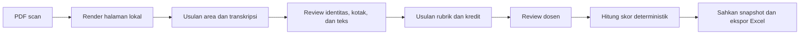

<div align="center">

# ASDOS

### Asisten koreksi tulisan tangan yang menjaga dosen tetap memegang keputusan.

Transkripsi literal, pemetaan jawaban, dan usulan berbasis rubrik dalam satu aplikasi lokal. Setiap perubahan tetap bisa ditinjau; nilai akhir hanya disahkan oleh dosen.


</div>

ASDOS membantu dosen mengolah lembar jawaban hasil scan: dari PDF menjadi area jawaban, transkripsi literal, bukti untuk usulan penilaian, review, lalu workbook Excel. Model hanya membuat **draf**. Identitas dan pemetaan perlu diperiksa, rubrik harus disahkan, dan dosen mengesahkan nilai final.

> **Status proyek:** prototipe lokal yang masih dievaluasi. Akurasi umum tulisan tangan Indonesia belum dibuktikan dengan gold set lintas penulis atau locked test. Jangan gunakan keluaran model sebagai nilai final tanpa review dosen.

## Alur kerja



## Fitur utama

- **Pemrosesan lokal:** render PDF dan inferensi berjalan di komputer/server yang menjalankan ASDOS. Tidak ada API OCR berbayar yang diwajibkan.
- **Review berbasis bukti:** periksa halaman, kotak, transkripsi, identitas, dan pemetaan sebelum menerima usulan.
- **Penilaian terkontrol:** rubrik yang disahkan menjadi dasar usulan per kriteria; kode domain menghitung bobot dan skor secara deterministik.
- **Jejak revisi:** dokumen asli dipertahankan, perubahan disimpan sebagai revisi, dan finalisasi mengunci snapshot.
- **Ekspor konsisten:** workbook dibuat dari snapshot; proses ekspor tidak menjalankan model ulang.
- **Mode manual:** alur review dan transkripsi manual tetap tersedia bila checkpoint atau perangkat model tidak siap.

### Batas model yang perlu diketahui

Qwen lokal menangani lokalisasi, usulan identitas, pembuatan acuan, dan usulan kredit. Checkpoint TrOCR hasil fine-tuning dengan pseudo-label AI tersedia sebagai **opsi eksperimen transkripsi** di workspace pengembang, tetapi bobot dan data training tidak disertakan di repository. Pengukuran yang tersedia hanya menunjukkan kecocokan pada data training berlabel AI—bukan akurasi manusia atau generalisasi. Hasil TrOCR diberi flag review dan tidak bisa langsung dipakai meminta usulan nilai.

Model tidak menggantikan deteksi kesalahan tulisan, adjudikasi identitas, persetujuan rubrik, atau pengesahan dosen. Detail penggunaan dan batas evaluasi ada di [panduan visi](docs/04-vision-and-handwriting.md), [catatan integrasi TrOCR](docs/implementation/TROCR_INTEGRATION_2026-11-05.md), dan [kebijakan dataset](docs/09-evaluation-and-dataset.md).

## Mulai di komputer lokal

### Kebutuhan

- Python 3.12, `uv`, Node.js 22, dan `make`
- Docker Desktop untuk broker Redis pada profil native
- Apple Silicon dengan PyTorch MPS atau mesin CUDA yang didukung untuk model Qwen
- Koneksi internet dan ruang disk saat pertama kali mengunduh checkpoint model

### Jalankan

Dari root repository:

```bash
cp .env.example .env
make setup-model
make install-web
make start
```

Buka [http://127.0.0.1:8000](http://127.0.0.1:8000). `make setup-model` memasang runtime model dan mengunduh checkpoint Qwen pada revision yang dipatok. `make start` membangun UI, menjalankan migrasi, lalu menjalankan API dan worker model native. Pada penggunaan pertama, ASDOS meminta pembuatan akun owner melalui terminal. Perintah dan opsi pengembangan lain dijelaskan di [README operasional dan infrastruktur](docs/12-infrastructure-costs-operations.md).

Model default dari `.env.example` adalah Qwen. Untuk memilih TrOCR eksperimen, siapkan checkpoint lokal beserta manifest-nya, lalu atur:

```dotenv
ASDOS_TRANSCRIBER=trocr
ASDOS_TROCR_DIR=./data/private/trocr-all-2348-v1/model-final
```

TrOCR tidak menyediakan lokalisasi halaman, pembuatan acuan, atau penilaian. Qwen tetap dibutuhkan untuk fungsi-fungsi tersebut. Langkah integrasi serta persyaratan review ada di [catatan TrOCR](docs/implementation/TROCR_INTEGRATION_2026-11-05.md).

## Pemeriksaan dan pengembangan

```bash
make test
make check
make build-web
```

Suite memakai fixture sintetik dan tidak membuktikan akurasi model pada tulisan tangan nyata. Baca [laporan test](TEST_REPORT.md), [status implementasi](IMPLEMENTATION_STATUS.md), dan [roadmap](docs/11-implementation-roadmap.md) sebelum menganggap suatu gate selesai.

Untuk menjalankan API dan UI terpisah, atau memakai PostgreSQL/Redis Compose, lihat petunjuk rinci di [dokumentasi proyek](docs/).

## Privasi dan data

- Scan mahasiswa, transkripsi, identitas, database, checkpoint, dan ekspor **tidak disertakan** dalam repository publik.
- Folder `dataset/`, `data/`, `models/`, berkas `.env`, PDF, dan database di-ignore oleh Git. Tetap periksa `git status` sebelum membuat commit.
- Provisioning model mengunduh bobot dari sumber model; file jawaban tidak dikirim ke Hugging Face atau provider OCR.
- Dataset eksperimen TrOCR berisi label AI yang belum diverifikasi manusia. Baik dataset maupun bobot turunannya tetap privat; lisensi kode ASDOS tidak memberikan izin untuk data tersebut.
- Jangan unggah scan, NIM, nilai, secret, atau ekspor kelas ke issue, pull request, atau fixture publik. Gunakan data sintetik atau data yang izinnya jelas.

Batas privasi operasional, parser PDF, autentikasi, dan deployment dijelaskan di [keamanan dan privasi](docs/10-security-and-privacy.md). Untuk pelaporan kerentanan, ikuti [SECURITY.md](SECURITY.md).

## Kontribusi

Kontribusi kode, dokumentasi, dan fixture sintetik dipersilakan. Mulai dari [CONTRIBUTING.md](CONTRIBUTING.md), [aturan proyek](AGENTS.md), dan [roadmap](docs/11-implementation-roadmap.md). Perubahan OCR/model perlu menyertakan protokol evaluasi; perubahan skor perlu contoh angka dan pengujian batas. Jangan menyertakan data mahasiswa tanpa izin tertulis dan proses redaksi terpisah.

## Lisensi

Kode dan dokumentasi proyek dilisensikan dengan [Apache License 2.0](LICENSE). Lisensi ini **tidak** mencakup scan mahasiswa, dataset privat, bobot model yang tidak disertakan, atau layanan/dependensi pihak ketiga; periksa lisensi masing-masing.
