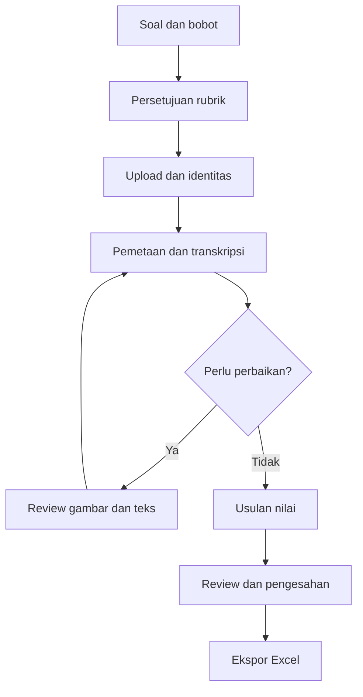

# 02 — Alur Pengguna dan UX

## Alur utama

Transkripsi dapat berjalan sebelum rubrik disetujui. Penilaian baru dimulai setelah versi soal/rubrik valid. Loop perbaikan hanya mengulang tahap yang dependensinya berubah, bukan otomatis merender seluruh kelas.

## Layar dan interaksi

| Layar | Informasi/tindakan | Pengaman UX |
| --- | --- | --- |
| Daftar assessment | Nama ujian, kelas, jumlah submission, status | Bedakan draft dan final; jangan tampilkan skor belum final sebagai final |
| Editor soal | Teks, gambar pendukung, nomor/subnomor | Hasil impor PDF adalah draft; konfirmasi jumlah dan label soal |
| Editor rubrik | Kunci, alternatif sah, kriteria, kredit, bobot | Tunjukkan total bobot; blok jika skor maksimum 0 atau ada konflik aturan |
| Upload batch | Daftar PDF, mahasiswa, kualitas, halaman, progres | Tinjau NIM; jangan menduga mahasiswa hanya dari nama file |
| Antrean koreksi | Status tiap submission/tahap, retry/cancel | Error per file; jangan menyuruh upload ulang semua file |
| Review jawaban | Bukti visual, teks, nomor, kriteria dan skor | Transkripsi dan skor usulan dapat diedit secara terpisah |
| Ringkasan pengesahan | Nomor belum selesai, perubahan manual, total | Finalisasi hanya jika seluruh penghalang diselesaikan |
| Hasil dan ekspor | Distribusi, rekap, unduhan | Tampilkan snapshot/version dan cakupan mahasiswa |

## Panel review utama

Panel kiri menampilkan halaman scan dengan zoom, putar tampilan, overlay batas jawaban dan badge nomor. Panel kanan menampilkan nomor aktif, potongan gambar, transkripsi literal, status keterbacaan, rubrik, skor usulan, skor reviewer, dan alasan. Navigasi berikutnya memprioritaskan penghalang finalisasi, bukan nilai terendah.

Klik bukti kriteria memusatkan gambar pada region/line terkait. Untuk jawaban lintas halaman, tampilkan daftar potongan berurutan beserta nomor halaman. Area tanpa penomoran tidak boleh hilang; tampilkan sebagai `unassigned` untuk dipetakan dosen. Region tumpang tindih ditandai untuk diperiksa.

Tombol penting: koreksi teks, tambah/pindah region, ubah nomor, tandai kosong terverifikasi, tandai tidak terbaca, usulkan nilai, terima usulan, simpan revisi, sahkan. Terima usulan tetap mencatat aktor manusia. Aksi bulk tidak boleh mengesahkan item berpenghalang.

Upload baru secara default menjalankan render → deteksi area → OCR literal → usulan pemetaan otomatis. Panel progres memperlihatkan tahap/counter aktual. Mode manual tetap menyediakan pemetaan → OCR. Hasil otomatis ditampilkan sebagai draf: dosen mengonfirmasi identitas lalu menyetujui atau memperbaiki pemetaan. Area tidak dikenal tetap memiliki gambar/teks untuk dipetakan melalui pilihan nomor; pengecualian bukan jawaban wajib beralasan. Untuk memindahkan area yang sudah terikat soal, pemetaan lama dapat dikosongkan tanpa menghapus area/OCR. Proses ulang tidak menimpa koreksi yang sudah ada.

Saat lembar dibuka kembali, UI mengambil job terbaru per tahap/jawaban untuk dokumen aktif dari API. Polling selama ada job aktif memperbarui status dan hasil tanpa menimpa draf koreksi yang sumber revisinya tidak berubah. Jika koneksi status gagal, UI memberi pesan mencoba terhubung kembali. Progress bar indeterminate dipakai bila worker belum menyediakan total; angka hanya ditampilkan dari counter aktual. Gagal/cancel menghentikan animasi; retry tersedia sesuai batas server. Membuka lembar menggulir ke atas agar panel progres terlihat.

## Visualisasi hasil

1. Progress per tahap: diterima, diproses, perlu review, disahkan, gagal. Persentase berdasarkan total submission, bukan task internal.
2. Histogram nilai final dan jumlah data yang masuk. Draft dapat dilihat terpisah dengan label eksplisit.
3. Rata-rata capaian per nomor sebagai persentase bobot nomor. Tampilkan ukuran sampel dan jumlah belum disahkan.
4. Daftar alasan review: kualitas gambar, nomor ambigu, angka/simbol meragukan, model tidak valid, dan ketidaksepakatan evaluator bila fitur itu diaktifkan.

Grafik tidak dipakai untuk menyimpulkan kemampuan pribadi dari tulisan atau membandingkan kelas yang rubriknya berbeda tanpa konteks.

## Keadaan khusus

| Kejadian | Perilaku |
| --- | --- |
| Halaman kosong | Tampilkan thumbnail; dosen dapat mengonfirmasi, jangan otomatis membuang |
| Halaman terbalik atau folio dua sisi | Tawarkan rotasi dan urutan halaman; simpan transform |
| Nomor 1 dibaca sebagai 7 | Reviewer mengubah pemetaan; nilai terkait menjadi stale |
| Mahasiswa melanjutkan nomor 2 di halaman akhir | Gabungkan region melalui urutan eksplisit, tanpa mengandalkan kedekatan halaman |
| Coretan dan dua jawaban akhir | Tampilkan asli dan penanda; minta keputusan jika maksud tidak jelas |
| Tidak ada jawaban nomor tertentu | Reviewer memeriksa halaman sebelum menandai kosong |
| Model gagal | Simpan pekerjaan manual; retry terbatas atau lanjut review manual |
| Rubrik berubah | Tampilkan dampak pada submission, buat versi baru dan pilihan rerun |
| Dua reviewer menyimpan bersamaan | Tolak revisi kedua yang basi, tampilkan diff, jangan last-write-wins |
| PDF mahasiswa yang sama diunggah dua kali | Peringatan hash dan identitas; pengguna memilih versi/attempt aktif |

Mengganti PDF pada submission mewajibkan konfirmasi identitas ulang untuk dokumen baru. UI menjelaskan bahwa final lama tetap arsip, sementara koreksi dokumen pengganti adalah draft baru. Mengubah polygon/orientasi pemrosesan membuat revisi image/region/layout; zoom atau putar tampilan sesaat tidak mengubah sumber penilaian.

## Aksesibilitas dan interaksi

Status memakai teks/ikon selain warna; fokus keyboard terlihat; panel dapat diubah ukurannya; teks transkripsi dapat dibesarkan; tombol punya nama yang jelas. Nilai kosong ditulis “belum dinilai”, tidak “0”. Tampilkan waktu dalam zona instalasi/pengguna dan simpan UTC di backend. Desain desktop terlebih dahulu karena koreksi gambar memerlukan ruang; mobile boleh untuk melihat progres.

## Skenario penerimaan UX

Dosen menginput 3 soal berbobot 20/30/50, mengunggah satu PDF berisi jawaban tidak berurutan, memperbaiki pemetaan satu region, membetulkan satu kata OCR, menyetujui skor, dan mengekspor Excel tanpa menyalin nilai manual. Unduhan memperlihatkan nilai yang sama dan semua alasan perubahan dapat dilihat kembali.

### Batch kelas dan preview (5 November 2026)

Dosen dapat memilih hingga 100 PDF dan mengunggah semuanya dalam satu alur; browser perlu tetap terbuka sampai unggahan selesai. Setiap PDF memperoleh submission serta job terpisah, dan daftar memperlihatkan nama berkas, progres pekerjaan serta identitas OCR sebagai usulan. Setelah dosen mengonfirmasi identitas dan mapping, jawaban siap otomatis masuk antrean usulan nilai, tetap memerlukan tinjauan sebelum pengesahan. Bila gagal/ambigu, tindak lanjut manual tetap tersedia. Pemilihan area memperlihatkan label nomor, status dipilih, dan pratinjau kotak saat ditarik; pemetaan nomor dapat dikosongkan tanpa menghapus region atau histori.
