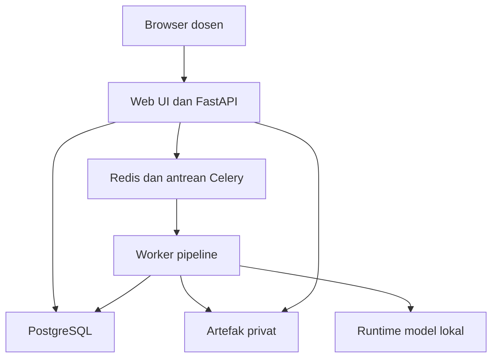

# 03 — Arsitektur Sistem

## Bentuk sistem

Bangun modular monolith dengan proses web/API dan worker terpisah. Domain penilaian tetap satu codebase; proses berat tidak berjalan pada request HTTP. Pemisahan proses memungkinkan pembatasan resource parser/inferensi tanpa memperkenalkan microservices sejak awal.



Redis membawa pesan job; PostgreSQL menjadi sumber status, versi, dan hasil. Artefak besar disimpan sebagai file privat di volume lokal. API hanya memberikan akses setelah otorisasi; jangan expose volume sebagai static directory publik.

## Stack usulan

| Lapisan | Pilihan awal | Alasan dan batas |
| --- | --- | --- |
| Backend | Python 3.12, FastAPI, Pydantic | Dekat dengan ekosistem CV; validasi kontrak bertipe |
| Domain/data | SQLAlchemy, Alembic, PostgreSQL versi supported | Transaksi, constraint, migrasi, audit; versi dikunci saat M1 |
| Background jobs | Celery + Redis | Retry dan isolasi kerja berat; status bisnis tetap di DB |
| PDF rendering | pypdfium2/PDFium | Render terkontrol, provenance lisensi harus dipaketkan |
| Image processing | OpenCV headless, Pillow | Deskew, orientasi, quality check; perubahan non-destruktif |
| Pengenalan teks | Baseline PP-OCRv5 Latin/Indonesia; kandidat Qwen3-VL-4B-Instruct | Pilih berdasarkan data lokal, bukan reputasi model saja |
| Penilaian semantik | Kandidat model Qwen yang sama, konteks terpisah | Mulai satu checkpoint agar deployment sederhana; benchmark oracle-text wajib |
| Inferensi awal | PyTorch/Transformers melalui adapter | Pin versi kompatibel; runtime akselerasi lain hanya setelah profiling |
| Frontend | React + Vite + TypeScript | SPA untuk pekerjaan review; tidak membutuhkan SSR |
| Visual PDF | PDF.js + overlay SVG/canvas | Mapping koordinat harus sama dengan renderer backend |
| Excel | XlsxWriter | Pembuatan workbook dengan tipe sel eksplisit; baca ulang untuk tes melalui openpyxl |
| Pengujian | pytest, property tests, browser E2E | Scoring, kontrak, worker recovery, dan flow review |
| Packaging | Docker Compose, profil CPU/GPU | Satu host privat dahulu; bukan jaminan semua backend jalan pada semua OS |

Nama/version di tabel adalah keputusan desain awal. M1 harus membuktikan instalasi dependency dan checksum model pada OS/arsitektur sasaran. Jangan memakai `latest` untuk image/checkpoint rilis atau menganggap dukungan CUDA sama dengan Apple MPS. Paddle dan PyTorch dapat ditempatkan pada image worker berbeda jika konfliknya terbukti; jangan memisahkannya sebelum perlu.

## Modul dan tanggung jawab

| Modul | Memiliki | Tidak memiliki |
| --- | --- | --- |
| assessment | Soal, rubrik, bobot, persetujuan versi | Rendering dan inferensi |
| submissions | Identitas, file, attempt, halaman | Keputusan kebenaran jawaban |
| vision | Render, transform, quality, region, transkripsi | Kunci jawaban saat OCR |
| grading | Kriteria, bukti, usulan, validasi dan kalkulasi | Hak mengesahkan atas nama dosen |
| review | Edit, konflik, pengesahan dan revisi | Menimpa jejak lama |
| exports | Snapshot ke workbook | Memanggil model atau menilai ulang |
| jobs | Scheduling, timeout, idempotency, recovery | Menjadi satu-satunya penyimpan nilai |
| access/audit | Otorisasi resource, sesi, audit minimal | Isi scan di log umum |

## Struktur source setelah implementasi

Ini struktur target; direktori aplikasi berikut **belum dibuat**.

```text
apps/api/                 HTTP, authentication, dependency wiring
apps/worker/              Celery tasks dan stage runner
apps/web/                 React UI
packages/domain/          rubrik, scoring, state transitions
packages/pipeline/        rendering, segmentasi, transkripsi, grading
packages/adapters/        database, model, file store, Excel
tests/unit/               domain dan validator
tests/integration/        DB, queue, file, export
tests/e2e/                skenario browser sampai Excel
benchmarks/               manifest, protokol, laporan; tanpa data privat
deploy/                   Compose, profil hardware, konfigurasi contoh
docs/                     dokumen dalam paket ini
agent-skills/           panduan agent per domain
```

## Interface minimal

`DocumentRenderer.render(document, limits)` menghasilkan halaman beserta ukuran, rotasi dan transform. `Transcriber.transcribe(region_images, language)` menghasilkan literal transcript dan referensi visual tanpa menerima rubrik. `Grader.evaluate(question_revision, rubric_revision, transcript_revision, evidence_refs)` menghasilkan keputusan kriteria terstruktur. `GradeCalculator.calculate(validated_criterion_results, weights)` menghasilkan angka deterministik. `ArtifactStore` membaca/menulis key internal; `GradeExporter` hanya menerima immutable snapshot.

Tidak semua interface perlu menjadi framework/plugin dinamis. Protocol/type biasa dengan satu implementasi awal memadai. Kontrak lintas tahap harus JSON-compatible, terversi, dan tervalidasi sebelum hasil masuk status sukses.

## Eksekusi job yang dapat dipulihkan

1. API menyimpan command/job dan outbox event dalam transaksi DB yang sama.
2. Dispatcher mengirim pesan job ID; pengiriman berulang diizinkan.
3. Worker mengambil lease untuk job/stage yang input fingerprint-nya sama. Satu hasil aktif per fingerprint ditegakkan DB.
4. Worker menulis artefak sementara, memvalidasi, lalu commit metadata dan status hasil secara atomik. Rename file lokal harus atomik di filesystem yang sama.
5. Worker mengakui pesan setelah hasil tersimpan. Pesan duplikat membaca hasil sukses, tidak mengulang efek samping.
6. Reconciler menjadwalkan job queued/lease kedaluwarsa dari DB bila pesan hilang. Heartbeat mencegah kerja sehat dianggap macet.

Fingerprint mencakup hash file, stage, versi preprocess/model/prompt/schema, serta ID revisi input yang relevan. Identitas mahasiswa tetap berada di konteks submission sehingga deduplikasi tidak menyatukan mahasiswa berbeda. Hasil dengan input yang sudah stale boleh disimpan untuk audit, tetapi tidak dipromosikan menjadi hasil aktif.

Retry hanya untuk gangguan sementara, maksimum 2 retry otomatis dengan backoff/jitter awal; malformed PDF, rubrik invalid, dan output schema invalid yang berulang perlu tindakan manusia. Batas timeout diukur di M0; worker melepas resource pada cancel, timeout, dan exception. Uji pemulihan saat worker mati di antara write file dan commit DB.

Konfigurasi broker memakai serializer JSON dan pesan berisi ID, bukan objek pickle atau isi scan. Tetapkan visibility timeout, acknowledgment/shutdown dan hard/soft time limit selaras dengan durasi stage yang terukur; uji redelivery di sekitar batas tersebut. Queue tidak dipakai sebagai cache yang bebas eviction. Review lisensi versi Redis yang dikunci sebelum membundel distribusi; jangan mengasumsikan semua versinya memakai lisensi sama.

## Jalur deployment

MVP pada satu host: reverse proxy TLS → UI/API, PostgreSQL, Redis, worker CPU dan satu slot inferensi. Buka hanya port proxy; database, queue, dan runtime model tetap privat. Model dapat diprovisi sebelum mode offline diaktifkan. Object storage S3-compatible, skala worker multi-host, dan auth institusi adalah perluasan setelah kebutuhan terbukti.

Rujukan: dokumentasi FastAPI membedakan background task ringan dari pekerjaan berat yang lebih cocok memakai task queue terpisah. Lihat S06 dalam [sumber](17-sources.md).
