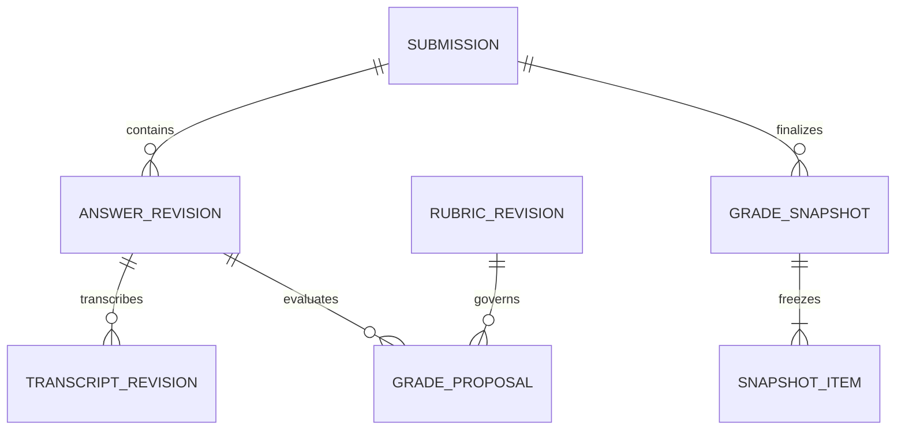

# 06 — Model Data, Versi, dan Status

## Prinsip penyimpanan

Gunakan UUID untuk ID internal, UTC untuk waktu, string untuk NIM/label nomor, NUMERIC untuk skor/bobot, hash SHA-256 untuk integritas artefak. Soft delete administratif bukan pengganti penghapusan privasi; proses purge memiliki lifecycle tersendiri. JSONB boleh untuk detail hasil model dan metadata, tetapi identitas, status, foreign key, serta angka penting tetap kolom/relasi tervalidasi.

## Entitas inti

| Entitas | Field utama dan relasi |
| --- | --- |
| users | id, login, password_hash, role, disabled_at; tidak menyimpan plaintext password |
| assessments | id, owner_id, title, course_label, active_revision_id, lifecycle_status |
| assessment_members | assessment_id, user_id, permission; unique pasangan |
| assessment_revisions | id, assessment_id, sequence, question_set_hash, scoring_policy_version, approved_by/at |
| question_revisions | id, assessment_revision_id, stable_question_id, label, order, text, answer_type, weight |
| rubric_revisions | id, question_revision_id, reference_answer, allowed_alternatives, max_raw, approval metadata |
| rubric_criteria | id, rubric_revision_id, description, max_points, allowed_credit_levels dan anchors |
| students | id, owner_scope_id, external_student_id string, display_name; PII dipisahkan dari evaluator |
| submissions | id, assessment_id, student_id, attempt_no, active_document_id, active_review_revision_id, identity_status |
| identity_confirmations | id, submission_id, document_id/hash, identity_snapshot, confirmed_by/at; immutable dan tidak berlaku untuk dokumen pengganti |
| documents | id, assessment_id, submission_id nullable, draft_assessment_revision_id nullable, kind, storage_key, sha256, bytes, page_count, validation_status |
| pages | id, document_id, page_index; identitas halaman fisik stabil, bukan tempat overwrite render |
| page_image_revisions | id, page_id, sequence, parent_id, render_artifact_id, dimensions, orientation, transform/inverse metadata; immutable |
| document_layout_revisions | id, document_id, parent_id, ordered_page_image_revision_refs, created_by/at; immutable urutan/orientasi aktif |
| regions | id, page_id, page_image_revision_id, parent_region_id nullable, polygon, region_type, created_by, artifact_id; revisi polygon membuat ID baru |
| answer_revisions | id, submission_id, stable_question_id, revision_no, mapping_status, predecessor_id |
| answer_region_links | answer_revision_id, region_id, order; satu jawaban banyak region |
| transcription_revisions | id, answer_revision_id, literal_text, spans/flags, source=model/human, parent_id |
| model_runs | id, task_type, checkpoint/revision/hash, runtime, prompt/schema version, input_fingerprint, usage, status |
| grade_proposals | id, answer_revision_id, transcript_revision_id, rubric_revision_id, model_run_id, verdict, flags |
| criterion_results | proposal_id, criterion_id, credit, points, evidence_refs, rationale; unique per proposal/kriteria |
| review_revisions | id, submission_id, assessment_revision_id, document_id, layout_revision_id, identity_confirmation_id, sequence, status, based_on_revision_id |
| review_items | review_revision_id, question_revision_id, proposal_id nullable, accepted/raw_override, source, reason |
| review_criterion_results | review_item_id, criterion_id, accepted_credit, points, evidence_refs, rationale, source=model_accepted/human, base_proposal_result_id nullable; unique per item/kriteria |
| grade_snapshots | id, submission_id, review_revision_id, identity_snapshot, document_id/hash, total_unrounded, final_score, approved_by/at, content_hash |
| grade_snapshot_items | snapshot_id, question_revision_id, raw/max/weight/contribution, verdict, result refs |
| grade_snapshot_criteria | snapshot_item_id, criterion_id, credit, max_points, points, evidence_refs, rationale, source; salinan keputusan kriteria yang disahkan |
| export_snapshots | id, assessment_id, assessment_revision_id, mode, scope, created_by/at, manifest_hash |
| export_snapshot_items | export_snapshot_id, submission_id, order, final_snapshot_id nullable, review_revision_id nullable, immutable payload skor/kriteria/teks/status/provenance dan content_hash; mendukung null pada draft |
| export_jobs | id, export_snapshot_id, status, artifact_id, expires_at |
| pipeline_jobs/stages | id, assessment_id, job_kind, submission_id nullable, draft_assessment_revision_id nullable, document_id, stage, input_fingerprint, attempt, lease/heartbeat, status, error_code |
| outbox_events | id, type, payload/job_id, published_at; transactional dispatch |
| artifacts | id, storage_key, kind, hash, bytes, parent_ids, retention_class, purged_at |
| audit_events | id, actor, action, resource IDs, revision refs, timestamp, request_id; konten sensitif dibatasi |

MVP dapat menunda `students` master lintas ujian dengan menaruh identitas dalam submission, tetapi scope unik NIM tetap harus jelas. Jangan menyamakan nama yang mirip dengan mahasiswa yang sama. ERD implementasi dan migrasi harus mengikuti pilihan ini secara konsisten.

## Hubungan penilaian

Diagram hanya hubungan inti; tabel di atas menjadi kamus model lebih lengkap.

## Constraint dan transaksi

- `UNIQUE(document_id,page_index)`, `UNIQUE(assessment_id, student_id, attempt_no)`, dan `UNIQUE(assessment_revision_id,label)` dalam scope ujian.
- Semua skor finite, tidak negatif, raw ≤ max, weight > 0; max rubrik sama dengan jumlah max kriteria. Cross-row constraint divalidasi service dalam transaksi dan diuji; jangan menganggap CHECK sederhana dapat menjumlah baris lain.
- Rubrik/soal/transkripsi/mapping yang sudah dipakai tidak diubah in-place. Buat revision baru dan simpan predecessor.
- Reference dari evidence hanya boleh ke region/span milik submission dan revisi yang sesuai. FK ownership diperiksa pada service/constraint yang relevan.
- Dokumen selalu memiliki assessment_id. `kind=student_answer` wajib memiliki submission_id pada assessment yang sama; `kind=question_source` wajib memiliki draft_assessment_revision_id dan tidak memiliki submission_id. Job question_import memakai scope assessment/draft/document, sedangkan submission_pipeline memakai assessment/submission/document. Validasi eksklusivitas jenis/scope; jangan menduga ownership dari path file atau submission yang nullable.
- Konfirmasi identitas mengikat mahasiswa ke document ID/hash yang diperiksa. Mengganti PDF mengubah identity_status menjadi pending dan memerlukan konfirmasi baru; finalisasi mencocokkan confirmation, document/layout dan review revision aktif. Snapshot final membekukan identitas saat pengesahan, sehingga perubahan profil/NIM berikutnya tidak mengubah nama pada ekspor final lama.
- Hanya satu review aktif per submission; optimistic concurrency dengan revision/ETag. Hanya satu attempt aktif untuk cakupan ekspor final, dipilih secara eksplisit.
- Finalisasi mengunci revision terkait, memeriksa blocker dan fingerprint, lalu menulis snapshot header/items serta audit dalam satu transaksi.
- Keputusan reviewer per kriteria disimpan pada review_criterion_results, tidak menimpa criterion_results proposal model. Finalisasi menyalinnya ke grade_snapshot_criteria. Untuk override tingkat nomor, hasil kriteria asal tetap terarsip sebagai informasi, tetapi tidak dianggap rincian nilai final; tandai sumber dan jangan mengarang alokasi poin.
- Export snapshot mengambil seluruh input dalam transaksi konsisten. Pada mode final, export_snapshot_items merujuk grade snapshot dan menyalin payload yang diperlukan. Pada mode draft, salin nilai/null, status/blocker, accepted criterion results bila ada, dan refs revisi aktif meski belum ada grade_snapshot. Payload draft tetap immutable agar edit berikutnya tidak mengubah workbook yang sedang dibuat.
- Final export mensyaratkan versi assessment seragam; bila tidak, harus dipisah ke export berbeda. Rubrik, transkripsi dan riwayat yang dimasukkan workbook juga dibatasi pada revision refs/cutoff waktu export snapshot, bukan hasil query live sesudahnya.

## State machines

Implementasi otomatis menambah `documents.auto_process` (false untuk data lama; default upload baru true) dan `documents.analysis_result` sebagai ringkasan/pointer hasil. `regions.analysis` menyimpan keluaran model terkait job/layout, bbox/label/flags, literal OCR, crop hash dan model-run refs. `regions.excluded_from_mapping` adalah keputusan manusia terpisah, diaudit dengan alasan. Geometri/output model lama tidak ditimpa oleh review.

Job `analyze_answers` melalui `locate_answers` → `transcribe_regions` → `map_answers`. Promosi region, mapping, transkripsi dan status sukses atomik setelah pemeriksaan lease/cancel, dokumen/layout serta snapshot kerja manual. Pemetaan aktif tidak ditimpa. `auto_mapped` menjadi `mapped` setelah konfirmasi manusia atau koreksi pemetaan eksplisit. Area belum dipetakan/dikecualikan memblokir finalisasi. Penggantian PDF tidak menampilkan mapping/transkripsi lama sebagai aktif.

| Objek | Status/transisi sah |
| --- | --- |
| assessment revision | draft → approved → superseded; revisi approved tidak diedit |
| pipeline stage | queued → running → succeeded / failed / cancelled; failed → queued melalui retry baru |
| answer revision | unmapped → mapped → transcribed → proposed → reviewed; perubahan input menghasilkan revision/stale relation |
| review revision | draft → ready → finalized; finalized tetap immutable, koreksi melalui draft baru |
| submission summary | uploaded / processing / needs_review / ready / finalized / failed / cancelled; status turunan dari revisi aktif |
| export job | queued → running → succeeded / failed / cancelled; snapshot input tetap sama |

`needs_review` adalah status bisnis, bukan berarti job gagal. Stage succeeded dapat menghasilkan transkripsi yang membutuhkan tinjauan. `stale` adalah hubungan hasil terhadap versi input aktif; simpan flag/relasi tersebut alih-alih mengubah hasil immutable.

## Invalidation dependensi

| Perubahan | Yang menjadi stale | Yang dapat dipakai ulang |
| --- | --- | --- |
| Ganti PDF | Konfirmasi identitas aktif, mapping/transkripsi/proposal/review untuk dokumen lama | Soal/rubrik, final snapshot dan audit lama |
| Urutan halaman berubah | Mapping/reading order dan hasil terkait pada layout baru; perlu validasi reviewer | Identitas tetap terikat dokumen yang sama; asli dan final lama utuh |
| Rotasi/preprocess yang mengubah gambar | Koordinat/region dan transkripsi turunannya | Asli dan versi transform lama |
| Pemetaan nomor/region berubah | Transkripsi yang konteks crop/order-nya berubah, proposal terkait | Render halaman |
| Teks diperbaiki dosen | Proposal untuk transcript revision lama | Gambar dan mapping |
| Soal/rubrik berubah | Proposal/review/snapshot baru diperlukan | OCR dan bukti gambar |
| Hanya bobot berubah | Review/total untuk assessment revision baru | Kredit mentah hanya boleh diadopsi melalui aksi tercatat jika rubrik identik |
| Format Excel berubah | Artefak export baru | Semua snapshot nilai |

Jangan menandai final lama “rusak” hanya karena ada draft baru; UI menjelaskan mana final terakhir dan mana revisi yang belum disahkan.

## Reproduksibilitas dan purge

Manifest setiap model run merekam input refs/hash, seed bila berlaku, decoding config, image size/token limits, perangkat/runtime, model checkpoint revision, prompt/schema, dan waktu. Hasil model tidak dijamin identik bit demi bit antarperangkat; simpan output valid yang benar-benar digunakan. Setelah purge data, audit minimal dapat menyisakan event penghapusan/hash yang dibolehkan kebijakan, tanpa teks/scan yang sudah diminta dihapus. Reproduksi penuh tidak lagi dijanjikan setelah bukti dipurge.
